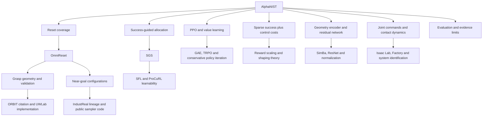

# AlphaNIST: papers, concept graph, and evidence audit

The paper is downloaded: **[AlphaNIST: Emergent Assembly Skills from Binary Task Rewards](papers/AlphaNIST-2610.13354v1.pdf)**, arXiv:2610.13354v1, 9 October 2026. This archive follows the supplied conversation into OmniReset, SGS, their dependencies, relevant predecessor code, and the foundations needed to interpret the method.

**[Open the interactive concept graph](concept-graph.html)** in a browser. It is a standalone, offline HTML file with search, an expandable tree, parent/dependency navigation, source links, and a separate view of unresolved questions. Keep it in this folder so relative PDF links work.

| Deliverable | Contents |
|---|---|
| [Full concept tree](CONCEPT-TREE.md) | All 165 concepts; shared dependencies are cross-referenced rather than duplicated indefinitely |
| [Sourced concept definitions](CONCEPTS.md) | Definitions, evidence locations, dependencies, and explicit inference labels |
| [Remaining ambiguities](AMBIGUITIES.md) | 20 evidence boundaries, each with a concrete closure requirement |
| [Paper index](PAPERS.md) | 40 downloaded PDFs, the NIST article HTML, and supporting sources, annotated by concept |
| [Machine-readable graph](concept-graph.json) | 165 nodes and 311 directed explanatory links |
| [Research audit](RESEARCH-AUDIT.md) | Scope, recursive trails, citation coverage, provenance, and verification limits |

## What the papers establish

AlphaNIST combines a shared policy across heterogeneous assembly tasks, a bank of diverse reset states, adaptive success-based allocation, geometry observations, and large-scale PPO. The positive assembly reward is sparse; control penalties are dense. OmniReset explains why the reset bank includes contact-rich intermediate states, while SGS explains why training effort should shift among the available states. These are different functions: the sampler cannot generate a useful state missing from the bank. ([AlphaNIST](papers/AlphaNIST-2610.13354v1.pdf), IV; [OmniReset](papers/OmniReset-2603.15789.pdf), 3; [SGS](papers/SGS-2610.12465.pdf), 3.)



This is only the overview. The linked full tree includes mathematical definitions, control/physics mechanisms, comparison methods, and the conversation’s soccer trail.

## Details that change the interpretation

| Issue | What the audit found |
|---|---|
| Reset generation versus sampling | OmniReset describes four reset families. SGS describes three and modifies their construction. AlphaNIST says it adapts OmniReset; that does not specify an identical bank. |
| “No demonstrations” | Reset generation still uses human-supplied object/goal geometry, workspace limits, grasp tests and success criteria. These are priors, even without action demonstrations. |
| AlphaNIST versus SGS weighting | AlphaNIST Eq. 4 uses `q_i ∝ epsilon_q + sqrt(p_i(1-p_i))`. SGS also applies temperature; its manipulation default is `T=2`. Ignoring epsilon, that default produces a fourth-root dependence rather than AlphaNIST’s square root. Exact inherited defaults remain unresolved. |
| “Binary reward” | The full objective subtracts `c * (||a||² + ||qdot||² + ||tau||²)`. The numerical `c` and relevant scaling conventions are absent. Squared torque is not mechanical energy. |
| Dense-reward comparison | AlphaNIST reports `.01` reach/alignment weights as matching OmniReset. OmniReset v3 and inspected public configuration list `.1` related weights. The exact term/scaling correspondence needs clarification. |
| Network inputs | Figure 3’s listed proprioception/action dimensions sum to 30 but its input is labeled 150. Five-frame stacking is plausible, but remains an inference. Point-cloud sampling and aggregation also lack a complete specification. |
| Evaluation | The headline 98.2% is training success at 64K environments. The 97.4% scaling result is mixed-reset evaluation at 256K. Neither is a real-hardware or table-only assembly success rate. |
| Multiple assemblies | The paper reports separately trained policies for one through ten active pairs, reaching 84% for ten. Twenty simultaneous active pairs and physical deployment remain future work. |

Source locations and the complete qualifications are attached to the corresponding nodes in [CONCEPTS.md](CONCEPTS.md), especially [sampling differences](CONCEPTS.md#sampler_difference), [reward scaling](CONCEPTS.md#reward_scaling), [reward comparison](CONCEPTS.md#gap_reward_comparison), [observation ambiguity](CONCEPTS.md#gap_observation), and [evaluation](CONCEPTS.md#evaluation).

## Where the recursion stops

Every represented branch ends at a sourced, self-contained explanation, another shared node, or an explicit evidence boundary. The graph distinguishes **documented**, **derived**, and **undocumented** claims, and separately labels AlphaNIST mechanisms, predecessor details, foundations, and comparisons. “Documented” does not mean AlphaNIST adopted a predecessor’s implementation.

There is no defensible claim of literal zero ambiguity or full reproducibility. The remaining 20 boundaries include reset-bank data and construction, sampler parameters and synchronization, exact success metric, reward scaling/timing, PPO settings, observation/encoder details, action distribution, controller and physics configuration, multi-pair setup, evaluation independence, compute accounting, and unestablished causal/hardware results. They are enumerated in [AMBIGUITIES.md](AMBIGUITIES.md). **No evidence found justifies labeling any of these proprietary.** The appropriate labels are undocumented/unreleased, unresolved correspondence, or not yet empirically established.

The scope is the operational explanation of AlphaNIST and the requested conversation trails. It does not recursively download every bibliography in robotics or claim that mathematical primitives have no further foundations. Background-only AlphaNIST citations and their disposition are listed in the audit.

## Reuse and verification

The [shared conversation](sources/shared-conversation.json) and its [raw page](sources/shared-conversation.html) are archived locally. It is treated as a question trail and checked against papers, including the correction to the bipedal DeepMind soccer paper. The UWLab code snapshot is pinned to commit `2b40afb9693d46bc1b1a91c7ba95e03c04daa60d`; it is not asserted to be the paper’s experimental revision.

Download hashes and PDF versions are in [sources/papers.json](sources/papers.json) and [sources/support.json](sources/support.json). The graph is generated from [research/build_graph.py](research/build_graph.py); paper annotations come from [research/catalog.py](research/catalog.py). Rebuild with:

```sh
python3 research/build_graph.py
python3 research/catalog.py
python3 research/build_graph.py
python3 research/check_graph.py
node research/check_explorer.cjs
```

Checks validate graph reachability, cycles, evidence references, archived file hashes, PDF readability, local document links and explorer JavaScript behavior. They do not reproduce the training experiments. Browser visual review was unavailable: automatic approval rejected serving the project because it contains the shared conversation, and the browser security policy blocked local-file URLs. Local structural and JavaScript checks are recorded in [research/VALIDATION.txt](research/VALIDATION.txt).
